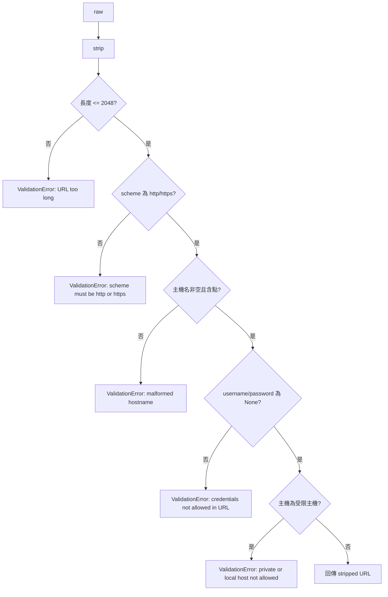

# Design Document
## Overview
在 `validate_url` 中新增三項檢查:長度上限、userinfo 拒絕、受限主機(localhost / 內網 / 迴路 IP 字面值)拒絕。三者皆為純字串解析,使用標準庫 `urllib.parse` 與 `ipaddress`,不做 DNS 解析、不新增依賴。`validate_url` 對外簽名與錯誤型別 `ValidationError`(`ValueError` 子類)不變,因此 `api/routes.py` 與 `mcp_server/server.py` 無需修改。

設計重點:

- 每項檢查為一個小函式(`_reject_too_long`、`_reject_userinfo`、`_reject_private_host`),`validate_url` 只負責依序呼叫。
- 錯誤訊息一律為固定字串,不插入任何輸入內容,避免憑證進入 API 回應與日誌。
- 既有訊息 `scheme must be http or https`、`malformed hostname` 原樣保留。

## Architecture
### 驗證順序(fail-fast)



順序理由:長度檢查最便宜且能在 `urlparse` 之前擋掉超長輸入;其後維持既有「scheme → 主機名」順序,新增檢查接在既有檢查之後,因此既有輸入(合法與非法)得到的結果與訊息不變,唯一例外是超過 2048 字元者會先得到長度錯誤。

### 關於 IPv6 與既有「需含點」檢查

既有主機名檢查要求含點,純 IPv6 字面值(如 `[::1]`、`[2001:db8::1]`)不含點,因此已先被 `malformed hostname` 拒絕,此為既有行為且維持不變。`_reject_private_host` 仍完整支援 IPv6,理由有二:

1. IPv4-mapped IPv6(如 `[::ffff:127.0.0.1]`)含點,會通過既有檢查,必須由本檢查攔截。
2. 日後若放寬主機名檢查,受限主機防線不需再改動。

因此 IPv6 的 example 測試直接呼叫 `_reject_private_host`,同時對 `validate_url("http://[::1]/")` 斷言最終仍拋出 ValidationError。

## Components and Interfaces
修改檔案:`src/keeplink_mcp/mcp_server/url_validator.py`(預估 < 120 行,遠低於 500 行上限)。

```python
"""URL validation and normalization for archive requests."""

import ipaddress
from urllib.parse import ParseResult, urlparse

MAX_URL_LENGTH = 2048

# 固定訊息:不得插入輸入內容,避免憑證進入回應與日誌
MSG_TOO_LONG = f"URL too long (max {MAX_URL_LENGTH} characters)"
MSG_SCHEME = "scheme must be http or https"          # 既有,不變
MSG_HOSTNAME = "malformed hostname"                   # 既有,不變
MSG_USERINFO = "credentials not allowed in URL"
MSG_PRIVATE_HOST = "private or local host not allowed"


class ValidationError(ValueError):
    """URL validation failure with descriptive message."""


def validate_url(raw: str) -> str: ...

def _reject_too_long(url: str) -> None: ...
def _reject_userinfo(parsed: ParseResult) -> None: ...
def _reject_private_host(hostname: str) -> None: ...
def _is_restricted_ip(ip: ipaddress.IPv4Address | ipaddress.IPv6Address) -> bool: ...
```

### validate_url

```python
def validate_url(raw: str) -> str:
    url = raw.strip()
    _reject_too_long(url)
    parsed = urlparse(url)
    if parsed.scheme not in ("http", "https"):
        raise ValidationError(MSG_SCHEME)
    hostname = parsed.hostname or ""
    if not hostname or "." not in hostname:
        raise ValidationError(MSG_HOSTNAME)
    _reject_userinfo(parsed)
    _reject_private_host(hostname)
    return url
```

### _reject_too_long

`len(url) > MAX_URL_LENGTH` 時拋出 `ValidationError(MSG_TOO_LONG)`。傳入的是已 strip 的字串,故空白不計入。

### _reject_userinfo

`parsed.username is not None or parsed.password is not None` 時拋出 `ValidationError(MSG_USERINFO)`。僅看 `urlparse` 解析出的 netloc userinfo,因此 path、query、fragment 中的 `@` 不會誤判。

### _reject_private_host

輸入為 `parsed.hostname`(已小寫、已去除 IPv6 方括號)。

1. 正規化:`host = hostname.rstrip(".")`,避免以 `localhost.` 繞過(含點會通過既有檢查)。
2. 若 `host == "localhost"` 或 `host.endswith(".localhost")`,拋出 `ValidationError(MSG_PRIVATE_HOST)`。
3. 嘗試 `ipaddress.ip_address(host)`;`ValueError` 代表不是 IP 字面值(一般網域名),直接放行,不做 DNS。
4. 若為 IPv6 且 `ip.ipv4_mapped` 非 `None`,改以對應的 IPv4 位址判定。
5. `_is_restricted_ip` 為真時拋出 `ValidationError(MSG_PRIVATE_HOST)`。

### _is_restricted_ip

回傳 `is_loopback or is_private or is_link_local or is_reserved or is_unspecified or is_multicast`。

## Data Models
無資料庫 schema 變更、無新設定項、無新依賴。常數 `MAX_URL_LENGTH` 為模組級常數,不暴露為環境變數(規則已由使用者確認為固定值 2048)。

## Error Handling
| 情境 | 錯誤訊息(固定字串) | 備註 |
|------|----------------------|------|
| 長度 > 2048 | `URL too long (max 2048 characters)` | 不含輸入內容 |
| scheme 非 http/https | `scheme must be http or https` | 既有 |
| 主機名空或無點 | `malformed hostname` | 既有 |
| 含 userinfo | `credentials not allowed in URL` | 不含帳密 |
| 受限主機 | `private or local host not allowed` | 不含主機名 |

`api/routes.py` 以 `str(exc)` 組成 422 回應、`server.py` 組成 `Invalid URL format: {exc}`,兩者因訊息固定而不會回顯 URL,無需修改。

## 既有測試影響評估

已 grep `validate_url` 與測試中的 `localhost`、`127.0.0.1`、`192.168`、`10.x`、`[::1]`、userinfo 形式的 URL,結果如下:

| 檔案 | 使用的位址 | 影響 | 處置 |
|------|-----------|------|------|
| `test/test_url_validator.py` | `https://localhost`(預期拒絕) | 仍拒絕(既有無點檢查先攔下) | 不改 |
| `test/test_url_validator.py` | 產生器 `[a-z][a-z0-9]{0,10}\.[a-z]{2,6}` | TLD 最長 6 字元,無法產生 `.localhost`(9 字元)或 IP 字面值 | 不改 |
| `test/test_cite_endpoint_properties.py` | `http://localhost`、`https://localhost`(預期無效) | 仍為無效 | 不改 |
| `test_archive_and_cite_tool.py`、`test_archive_and_cite_tool_properties.py`、`test_mcp_server.py`、`test_retry_task.py` | `BASE_URL = "http://127.0.0.1:9210"` | 這是後端 API 基底位址,由 MCP 端 `httpx` 使用,不經過 `validate_url` | 不改 |

結論:沒有既有測試需要更新。若實作後 `pytest` 發現例外,以實際失敗為準,在對應任務中補修並記錄。

## 已知限制(範圍外)

- 不做 DNS 解析,因此公網網域解析到內網位址(DNS rebinding)不在本次防護範圍;使用者已選擇避免 I/O 與 TOCTOU。
- 非標準 IPv4 寫法(如 `127.1`、十進位整數 `2130706433`、`0x7f.0.0.1`)無法被 `ipaddress.ip_address` 解析。其中不含點者已被既有主機名檢查拒絕;`127.1`、`0x7f.0.0.1` 這類含點的寫法會被視為一般網域名而通過。此缺口屬於「只用 `ipaddress`」的規則邊界,於 handoverbook 安全性摘要中註記,不在本次處理。
- CGNAT(`100.64.0.0/10`)不在使用者指定的類別內,不被拒絕。

## Testing Strategy
新增測試檔 `test/test_url_validator_hardening.py`(新功能即新模組,避免擴張既有測試檔);既有 `test/test_url_validator.py` 不修改。

- Example 測試:IPv4(127.0.0.1、10.0.0.1、172.16.0.1、192.168.1.1、169.254.169.254、0.0.0.0、224.0.0.1、240.0.0.1)、IPv6(`::1`、`fe80::1`、`fc00::1`、`::`、`ff02::1`、`::ffff:127.0.0.1`)、localhost 變體(`LOCALHOST.`、`a.localhost`)、userinfo(含只有 username)、`@` 在 path/query 的接受案例、query 含 token 的接受案例、長度 2048 通過 / 2049 拒絕 / 前後空白不計入、公網 IP(`93.184.216.34`)通過、驗證順序(超長 + ftp 得到長度錯誤)、`socket.getaddrinfo` 被 monkeypatch 為拋錯以證明未做 DNS。
- Property 測試(hypothesis,`max_examples=100`):下列 Properties 1 至 5。受限網段使用測試內獨立列出的 CIDR 清單產生位址,不呼叫實作的 `_is_restricted_ip`,避免循環驗證。
- 整合 example:對 `/api/archive`、`/api/cite` 各送一筆帶帳密 URL 與一筆內網 URL,斷言 HTTP 422、回應文字不含帳密、資料庫任務數不變(沿用 `test_cite_endpoint_properties.py` 的 fixture 風格)。
- 不使用 PBT 的部分:依賴 / 版本約束(smoke,以 `check_version.py` 與 `git diff` 確認)。

## Correctness Properties
*屬性是在系統所有有效執行下都應成立的特性,是人類可讀規格與機器可驗證正確性保證之間的橋樑。*

### Property 1:受限 IPv4 字面值一律被拒絕

For any http 或 https scheme 與任意落在 loopback、private、link-local、reserved、unspecified、multicast 網段內的 IPv4 字面值主機,`validate_url` SHALL 拋出 ValidationError。

**Validates: Requirements 2.2, 2.6**

### Property 2:公網 IPv4 字面值通過

For any http 或 https scheme、任意不屬於上述受限網段的 IPv4 字面值主機與任意簡單 path,`validate_url` SHALL 回傳 stripped 後的原字串。

**Validates: Requirements 2.5, 4.4**

### Property 3:帶 userinfo 的 URL 被拒絕且訊息不洩漏帳密

For any 合法公網主機、任意 username(可為空 password 或無 password)與 password,含 userinfo 的 URL SHALL 使 `validate_url` 拋出 ValidationError,且錯誤訊息不包含 username、password 或完整 URL。

**Validates: Requirements 1.1, 1.2, 1.3, 5.1**

### Property 4:長度邊界

For any 長度 n 與合法公網主機,以 padding 組成 stripped 後長度恰為 n 的 URL,當 n ≤ 2048 時 `validate_url` SHALL 接受,當 n > 2048 時 SHALL 拋出 ValidationError;在前後附加任意空白不改變結果。

**Validates: Requirements 3.1, 3.2, 3.3, 3.4**

### Property 5:所有拒絕訊息皆為固定字串

For any 被 `validate_url` 拒絕的輸入(涵蓋超長、非法 scheme、無點主機、userinfo、受限主機),ValidationError 的訊息 SHALL 屬於固定訊息集合 `{MSG_TOO_LONG, MSG_SCHEME, MSG_HOSTNAME, MSG_USERINFO, MSG_PRIVATE_HOST}`。

**Validates: Requirements 4.7, 5.1**
