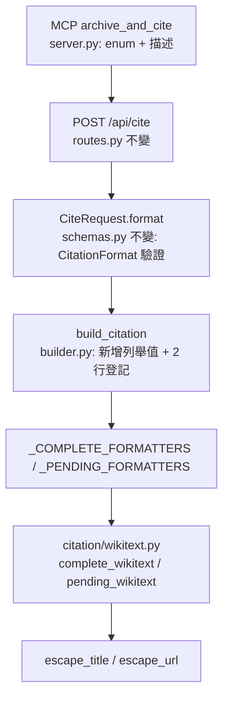

# Design Document: wikitext-citation-format

## Overview

在 `archive_and_cite` 的引用輸出新增第五種格式 `wikitext`,輸出 Wikipedia `{{cite web}}` 範本字串,內含封存欄位 `archive-url`、`archive-date`、`url-status`。實作方式沿用既定做法:寫純函式並登記到 `builder.py` 的兩張分派表(`_COMPLETE_FORMATTERS`、`_PENDING_FORMATTERS`),同步更新 MCP `inputSchema` 的 `format` enum。`CitationFormat` 為 str-Enum,`CiteRequest.format` 以它驗證,因此 API 層只需新增列舉值,不需改 `schemas.py` 與 `routes.py` 的程式碼。

設計邊界(已與使用者確認,不再變動):

- 欄位最小集:`title`、`url`、`archive-url`、`archive-date`、`url-status`。不輸出 `access-date`、作者、出版者、網站名稱。
- pending 沿用既有行為:只含 `url` 與說明存檔進行中(含 `task_id`)的資訊,沒有 `archive-url`。
- 不改動 markdown、bibtex、apa、plain 四種格式的任何輸出。
- `builder.py` 維持零 I/O 純函式;不新增執行期依賴;不需新帳號或 API key。

## 一手資料查證與決定

下表是本設計對開放問題的每一項決定。來源皆為設計時實際抓取的 Wikipedia 官方文件頁面。

| # | 問題 | 決定 | 依據 |
|---|---|---|---|
| D1 | 欄位順序 | `title`、`url`、`url-status`、`archive-url`、`archive-date` | [Template:Cite web](https://en.wikipedia.org/wiki/Template:Cite_web) 的「To cite an online web page that has been archived」範例順序為 `... title, url, ..., url-status, archive-url, archive-date, access-date`。我們取其中有資料的子集並保持相對順序 |
| D2 | `archive-date` 日期格式 | 沿用 builder 既有的 `YYYY-MM-DD`(ISO 8601) | Template:Cite web 的範例直接使用 `archive-date=2005-09-07`;[Help:Citation Style 1](https://en.wikipedia.org/wiki/Help:Citation_Style_1) 說明 CS1 會依文章設定自動重新渲染 `archive-date`,`cs1-dates=y` 即為年初數字格式。ISO 屬可接受格式 |
| D3 | `url-status` 合法值 | `dead`、`live`、`deviated`、`unfit`、`usurped`、`bot: unknown`。省略或空值時預設為 `dead` | [Template:Cite web](https://en.wikipedia.org/wiki/Template:Cite_web) 的 `url-status` 參數說明 |
| D4 | `url-status` 我們填什麼 | 固定填 `live` | 見下方「url-status 決策」 |
| D5 | `title` 內 `\|`、`[`、`]`、換行 | `\|` → `&#124;`;`[` → `&#91;`;`]` → `&#93;`;換行 → 空白 | [Help:Citation Style 1](https://en.wikipedia.org/wiki/Help:Citation_Style_1) 的 Titles and chapters 表格;[Template:Cite web](https://en.wikipedia.org/wiki/Template:Cite_web) 的 title 說明列出同一組替換 |
| D6 | `title` 內 `{`、`}` | `{` → `&#123;`;`}` → `&#125;`(逐字元,不判斷是否成對) | **推論,非文件明列**。依據:[Help:Template](https://en.wikipedia.org/wiki/Help:Template) 說明 `{ } \| [ ] < >` 為保留的 wiki 標記字元,並明列以 HTML 實體 `&#124;` 處理範本參數內的保留字元;[Help:Citation Style 1](https://en.wikipedia.org/wiki/Help:Citation_Style_1) 指出未編碼的 `}}` 會被當成範本結尾。數值實體與文件明列的 `&#91;`、`&#93;`、`&#124;` 同型態 |
| D7 | `title` 內 `<` | `<` → `&#60;` | **推論,非文件明列**。[Help:Template](https://en.wikipedia.org/wiki/Help:Template) 說明 `<!-- -->` 為隱藏註解語法;title 含 `<!--` 會吞掉後續參數。只跳脫 `<`,`>` 單獨出現無害,不跳脫 |
| D8 | `title` 內 `=` | **不跳脫** | [Help:Template](https://en.wikipedia.org/wiki/Help:Template):只有「未命名參數」的值不能含 `=`。我們全部使用具名參數 `\|title=...`,第一個 `=` 分隔名稱與值,值內後續的 `=` 保留原樣 |
| D9 | 為何不用 `{{!}}` | 採 `&#124;` | Help:Template 同時列出 `{{!}}` 與 `&#124;`,但 CS1 文件針對 title 明列的是 `&#124;`(與 `{{pipe}}`)。採文件針對此欄位明列者 |
| D10 | `title` 為 null/空 | 輸出空值的 `\|title=`,位置不變,**不以 URL 或其他值填補** | 見下方「title 缺失決策」 |
| D11 | `url` 與 `archive-url` 內的特殊字元 | 空白與 `"` `'` `<` `>` `[` `]` `{` `\|` `}` 以 UTF-8 百分比編碼 | [Help:Citation Style 1](https://en.wikipedia.org/wiki/Help:Citation_Style_1) 的 URL 編碼對照表:`%20 %22 %27 %3C %3E %5B %5D %7B %7C %7D`。該文件另說明單一 `'` 不編碼也可,本設計為求規則單純,逐字元全部編碼 |
| D12 | pending 說明放哪裡 | 放在範本內的 HTML 註解 `<!-- ... -->` | Help:Template 說明 `<!-- Comment -->` 是範本呼叫內的隱藏註解語法。cite web 沒有適合放進度說明的參數,註解不新增任何範本參數 |
| D13 | 單行或多行 | 單行(水平格式) | Template:Cite web 同時提供水平與垂直格式;水平格式為單一字串,貼進 `<ref>` 最直接 |

### url-status 決策

文件說明:省略或空值時等同 `dead`,連結會指向封存版;`live` 用於原始網址已被預先封存的情況,主連結維持原始網址。

KeepLink 不知道原始網址目前是否存活,所以三個選項各自的問題如下:

- **省略(隱含 `dead`)**:等於斷言原始網址已失效,而我們沒有這項資料。且使用者明確要求輸出 `url-status`。
- **`bot: unknown`**:誠實,但文件說明這個值是機器人「無法判斷時留下」的標記,頁面會被放進 `CS1 maint: bot: original URL status unknown` 維護分類,等編輯者人工處理。把它當預設輸出會替每個使用者製造維護工作。
- **`live`**:文件對 `live` 的定義描述的是「如何封存」(預先封存),而不是「現在探測到存活」。`archive_and_cite` 的流程正是在引用當下主動預先封存,且封存成功本身代表封存當時網址可讀取。

決定:固定輸出 `url-status=live`。這是對「封存當時」的最小可支持宣稱。殘餘風險:原網站日後失效時,編輯者或機器人需要把 `live` 改成 `dead`,這是 Wikipedia 既有維護流程。此值以具名常數 `URL_STATUS_LIVE` 暴露,未來若要改預設只需動一處。

### title 缺失決策

[Template:Cite web](https://en.wikipedia.org/wiki/Template:Cite_web) 說明 `title` 為必填,未定義會產生錯誤。[Help:CS1 errors](https://en.wikipedia.org/wiki/Help:CS1_errors) 的「Missing or empty \|title=」說明缺少與空值屬於同一類錯誤。

既有 bibtex、apa、plain 在 title 為 null 時以 `archived_url` 補位。wikitext 不照做,理由:`title` 在 cite web 中會被渲染成引文文字,以 URL 補位是向讀者呈現一個我們沒有的標題;使用者明確要求不得捏造。輸出 `|title=` 空值有三個好處:參數位置固定(屬性測試可驗證);編輯者貼上後會看到明確的「Missing or empty \|title=」錯誤而非悄悄通過;補上標題只需在等號後面填字。

### 已知限制(繼承自既有行為,不在本 spec 處理)

- `archived_at` 在快取命中時來源是 `ArchiveTask.updated_at`(最後變更時間),不是 Wayback 快照時間(見 `docs/reviews/2026-10-04-224335-pr-5.md`)。wikitext 的 `archive-date` 因此與其他格式一樣是近似值。
- `&` 不跳脫。title 若本身含字面的 `&#124;` 等實體文字,渲染後會被解讀為實體。這是刻意取捨:跳脫 `&` 會讓 `AT&T` 變成 `AT&amp;T`,可讀性變差。
- 本設計不呼叫 Wikipedia 做線上驗證(builder 零 I/O)。D6、D7 的渲染結果建議由使用者在 [Special:ExpandTemplates](https://en.wikipedia.org/wiki/Special:ExpandTemplates) 人工確認一次,屬一次性驗證,不納入自動化測試。

## Architecture

### 模組放置決策

已檢查 `src/keeplink_mcp/citation/builder.py` 目前為 **296 行**。直接加入 wikitext 預估增加約 90 行(兩個 formatter、兩個跳脫 helper、常數、docstring),合計約 390 行,仍低於 500 行上限。

仍決定獨立成 `src/keeplink_mcp/citation/wikitext.py`,理由:

1. 專案規則「新功能 = 新模組」,且跳脫規則(D5 到 D11)是獨立的關注點,有自己的測試面。
2. `wikitext.py` 不匯入 `builder.py`(只依賴 `datetime`、`re` 與 `urllib.parse`),`builder.py` 單向匯入它並登記,沒有循環匯入。
3. `builder.py` 只增加「列舉值 + import + 兩行登記」,既有四種格式的程式碼一行都不動,回歸風險最低。



### 一次只動一個模組的實作順序

1. `citation/wikitext.py`(新模組,含全部格式邏輯)
2. `citation/builder.py`(列舉值與登記)
3. `mcp_server/server.py`(enum 與描述文字)
4. 測試、文件

`api/schemas.py` 與 `api/routes.py` 不需要程式碼變更:`format: CitationFormat` 由 Pydantic 依列舉驗證,`routes.py` 原樣把 `request.format` 傳給 `build_citation`。`api/app.py` 的 422 記錄處理器對任何非法值皆適用。

## Components and Interfaces

以下依 Interface First 順序,先列簽名再於 Algorithmic Pseudocode 說明實作。

### `citation/wikitext.py`(新增)

```python
"""Wikipedia {{cite web}} formatter — pure functions, no I/O."""

from __future__ import annotations

from datetime import datetime

# 固定值,見 design 的 url-status 決策。
URL_STATUS_LIVE: str = "live"

def escape_title(title: str) -> str:
    """跳脫 title 內會破壞範本語法的字元。

    單趟 str.translate,不會二次跳脫;換行以空白取代。
    """

def escape_url(url: str) -> str:
    """對 url / archive-url 內會破壞範本語法的字元做 UTF-8 百分比編碼。"""

def complete_wikitext(
    *, title: str | None, original_url: str, archived_url: str, archived_at: datetime
) -> str:
    """Complete 態:單行 {{cite web |title= |url= |url-status= |archive-url= |archive-date=}}。"""

def pending_wikitext(*, original_url: str, task_id: str) -> str:
    """Pending 態:{{cite web |url=... <!-- Archiving in progress; task_id: ... -->}}。"""
```

簽名與 `builder.py` 內 `CompleteFormatter` / `PendingFormatter` 的關鍵字參數慣例完全一致,可直接登記進分派表。

### `citation/builder.py`(變更)

```python
class CitationFormat(str, Enum):
    MARKDOWN = "markdown"
    BIBTEX = "bibtex"
    APA = "apa"
    PLAIN = "plain"
    WIKITEXT = "wikitext"   # 新增,附加在最後以保持既有值順序

from keeplink_mcp.citation.wikitext import complete_wikitext, pending_wikitext

# 於既有兩張字典字面值的末端各加一行:
#   CitationFormat.WIKITEXT: complete_wikitext,
#   CitationFormat.WIKITEXT: pending_wikitext,
```

`build_citation` 的簽名、驗證與 fail-fast 邏輯完全不動。

### `mcp_server/server.py`(變更)

```python
"format": {
    "type": "string",
    "enum": ["markdown", "bibtex", "apa", "plain", "wikitext"],
    "description": (
        "Citation output format for the `formatted` field. One of "
        "markdown (default), bibtex, apa, plain, wikitext "
        "(Wikipedia {{cite web}} template with archive-url / archive-date / "
        "url-status). Only affects `formatted`; structured fields are unchanged."
    ),
},
```

## Data Models

### 輸出形狀(golden 範例)

輸入:`title="Example"`、`original_url="https://example.com/article"`、`archived_url="https://web.archive.org/web/20240101000000/https://example.com/article"`、`archived_at=2024-01-01 12:30:45`。

Complete:

```text
{{cite web |title=Example |url=https://example.com/article |url-status=live |archive-url=https://web.archive.org/web/20240101000000/https://example.com/article |archive-date=2024-01-01}}
```

Complete,title 為 null:

```text
{{cite web |title= |url=https://example.com/article |url-status=live |archive-url=https://web.archive.org/web/20240101000000/https://example.com/article |archive-date=2024-01-01}}
```

Complete,title 為 `A | B {{x}} [y]=z`(僅示意 title 欄位):

```text
{{cite web |title=A &#124; B &#123;&#123;x&#125;&#125; &#91;y&#93;=z |url=... }}
```

Pending(`task_id="task-abc-123"`):

```text
{{cite web |url=https://example.com/article <!-- Archiving in progress; task_id: task-abc-123 -->}}
```

### 跳脫對照表

| 欄位 | 字元 | 替換 | 來源 |
|---|---|---|---|
| title | `\|` | `&#124;` | D5 |
| title | `[` `]` | `&#91;` `&#93;` | D5 |
| title | `{` `}` | `&#123;` `&#125;` | D6(推論) |
| title | `<` | `&#60;` | D7(推論) |
| title | 換行類字元(`str.splitlines` 認定者) | 以單一空白連接 | D5 |
| title | `=` `&` `>` | 不變 | D8 |
| url、archive-url | 空白(含所有 Unicode 空白)、`"` `'` `<` `>` `[` `]` `{` `\|` `}` | `urllib.parse.quote(ch, safe="")` | D11 |

## Algorithmic Pseudocode

### 跳脫與組裝

```pascal
ALGORITHM escape_title(title)
INPUT: title of type String
OUTPUT: escaped of type String

BEGIN
  joined ← JOIN(" ", SPLITLINES(title))
  RETURN TRANSLATE(joined, {
    "|": "&#124;", "[": "&#91;", "]": "&#93;",
    "{": "&#123;", "}": "&#125;", "<": "&#60;"
  })
END
```

**Preconditions:** `title` 為字串(呼叫端已經 `normalize_title`,但本函式不依賴這點)。
**Postconditions:** 輸出不含 `| [ ] { } <` 與任何換行類字元;`=`、`&`、`>` 原樣保留;對相同輸入輸出相同。

```pascal
ALGORITHM escape_url(url)
INPUT: url of type String
OUTPUT: escaped of type String

BEGIN
  RETURN REGEX_REPLACE(url, /[\s"'<>\[\]{|}]/, ch → QUOTE(ch, safe=""))
END
```

**Preconditions:** `url` 為字串。
**Postconditions:** 輸出不含空白與 `" ' < > [ ] { | }`;不含這些字元的輸入原樣輸出(`%` 不重複編碼,避免已編碼 URL 被破壞)。

```pascal
ALGORITHM complete_wikitext(title, original_url, archived_url, archived_at)
INPUT: title (String or NULL), original_url, archived_url: String, archived_at: Datetime
OUTPUT: formatted of type String

BEGIN
  title_value ← IF title IS NULL THEN "" ELSE escape_title(title)
  date ← FORMAT(archived_at, "%Y-%m-%d")
  RETURN "{{cite web"
       + " |title="        + title_value
       + " |url="          + escape_url(original_url)
       + " |url-status="   + URL_STATUS_LIVE
       + " |archive-url="  + escape_url(archived_url)
       + " |archive-date=" + date
       + "}}"
END
```

**Preconditions:** `archived_url`、`archived_at` 皆非 null(`build_citation` 已 fail-fast 保證)。
**Postconditions:** 單行;以 `{{cite web ` 開頭、`}}` 結尾;範本主體恰有五個參數,順序固定;不含 `access-date`;title 為 null 時 `title` 值為空字串。

```pascal
ALGORITHM pending_wikitext(original_url, task_id)
INPUT: original_url, task_id: String
OUTPUT: formatted of type String

BEGIN
  note ← REPLACE(task_id, "-->", "-- >")      // 防止 task_id 提前結束 HTML 註解
  RETURN "{{cite web |url=" + escape_url(original_url)
       + " <!-- Archiving in progress; task_id: " + note + " -->}}"
END
```

**Preconditions:** 無(pending 態只有 `original_url` 與 `task_id`)。
**Postconditions:** 以 `{{cite web ` 開頭、`}}` 結尾;唯一的範本參數是 `url`;不含 `archive-url`、`archive-date`、`url-status`、`title`;對一般 `task_id`(不含 `-->`)原樣包含於註解中。

**Loop Invariants:** 無迴圈。

### 檔案與函式長度預算

| 檔案 | 預估行數 | 上限 |
|---|---|---|
| `citation/wikitext.py` | 約 90 | 500 |
| `citation/builder.py` | 約 303(+7) | 500 |
| 最長函式 | 約 15 | 50 |

## Example Usage

```python
from datetime import datetime
from keeplink_mcp.citation.builder import CitationFormat, build_citation

citation = build_citation(
    title="Example",
    original_url="https://example.com/article",
    task_id="task-abc-123",
    archived_url="https://web.archive.org/web/20240101000000/https://example.com/article",
    archived_at=datetime(2024, 1, 1, 12, 30, 45),
    format=CitationFormat.WIKITEXT,
)
assert citation.formatted.startswith("{{cite web |title=Example |url=")
assert citation.formatted.endswith("|archive-date=2024-01-01}}")
```

## Error Handling

| 情境 | 行為 |
|---|---|
| `format` 不在 enum(含大小寫錯誤) | 既有行為不變:`POST /api/cite` 回 422 並由 `app.py` 記錄 warning;MCP 端由 inputSchema 拒絕 |
| `archived_url` 與 `archived_at` 只設其一 | 既有行為不變:`build_citation` 拋 `ValueError`(fail-fast),不會進入 wikitext formatter |
| `title` 為 null / 空白 | `normalize_title` 轉 null,輸出 `\|title=` 空值(D10) |
| `title` 含保留字元 | 依跳脫表處理,不拋錯 |
| URL 含空白或保留字元 | 百分比編碼,不拋錯 |
| `task_id` 含 `-->` | 改寫為 `-- >`,避免註解被提前結束 |

不加入任何掩蓋錯誤的 fallback:缺少的資料(title)以可見的空欄位呈現,不以其他資料冒充。

## Security Considerations

輸出會被使用者貼進 wiki 原始碼。`title` 與 URL 來自呼叫端(AI agent 或網頁內容),屬不受信任輸入。跳脫的目的是讓不受信任的字串無法新增、刪除或重排範本參數,也無法提前結束範本或吞掉後續內容(`<!--`)。這是語法層級的防護,不處理語意層級的內容濫用。

## Dependencies

無新增依賴。`urllib.parse`、`datetime`、`re` 皆為標準函式庫;測試使用專案既有的 `hypothesis>=6.100.0` 與 `pytest`。Python >=3.10。

## Correctness Properties

*A property is a characteristic or behavior that should hold true across all valid executions of a system-essentially, a formal statement about what the system should do. Properties serve as the bridge between human-readable specifications and machine-verifiable correctness guarantees.*

測試用解析器 `parse_cite_web(formatted)`(僅存在於測試中,與實作不共用程式碼):去掉前綴 `{{cite web` 與後綴 `}}`,先移除 `<!-- ... -->` 註解,再以 `|` 切分,每段以第一個 `=` 分成名稱與值,並去除前後空白。

### Property 1: 範本封裝與單行

*For any* complete 輸入(任意 title 含 `|`、`{{`、`}}`、`=`、換行、Unicode;任意合法 URL;任意 archived_at),`format=WIKITEXT` 的 `formatted` 以 `{{cite web ` 開頭、以 `}}` 結尾,且不含換行字元。

**Validates: Requirements 2.1**

### Property 2: 參數集合與順序不被破壞

*For any* complete 輸入(含任意文字 title 與可能含空白或保留字元的 URL),以 `parse_cite_web` 解析 `formatted`,參數名稱序列恆等於 `["title", "url", "url-status", "archive-url", "archive-date"]`,因此不出現 `access-date`、作者、出版者、網站名稱等其他參數;`formatted` 中除開頭 `{{` 與結尾 `}}` 外不含 `{`、`}`。

**Validates: Requirements 2.2, 2.6, 3.3, 3.5, 4.1**

### Property 3: 欄位值正確

*For any* complete 輸入,解析結果中 `url` 等於 `escape_url(original_url)`,`archive-url` 等於 `escape_url(archived_url)`,`archive-date` 等於 `archived_at.strftime("%Y-%m-%d")`,`url-status` 等於 `live`。

**Validates: Requirements 2.3, 2.4, 2.5**

### Property 4: title 跳脫往返

*For any* 不含 `&` 的 title,把輸出的 `title` 值依六組實體(`&#124; &#91; &#93; &#123; &#125; &#60;`)反向替換,結果等於「title 經 `normalize_title` 後,換行類字元以單一空白連接」。含 `=` 的 title 原樣保留。

**Validates: Requirements 3.1, 3.3, 3.4**

### Property 5: title 缺失不捏造

*For any* complete 輸入且 title 為 null、空字串或純空白,解析結果的 `title` 值為空字串,且參數名稱序列與 Property 2 相同。

**Validates: Requirements 3.2**

### Property 6: pending 不含封存欄位

*For any* pending 輸入(合法 URL、uuid 形式 task_id),`format=WIKITEXT` 的 `formatted` 以 `{{cite web ` 開頭、以 `}}` 結尾,解析後的參數名稱序列恆為 `["url"]`,`formatted` 含 `task_id`、含 `Archiving in progress`,不含 `archive-url`、`archive-date`、`url-status`、`title=`。

**Validates: Requirements 5.1, 5.2**

### Property 7: 確定性

*For any* 輸入與 archive state,以 `format=WIKITEXT` 連續呼叫 `build_citation` 兩次,所得 `Citation`(含 `formatted`)完全相等。

**Validates: Requirements 6.1**

### Property 8: 既有格式逐位元組不變

*For any* 輸入、*for any* `format` 屬於 markdown、bibtex、apa、plain,以及兩種 archive state,`build_citation` 的 `formatted` 等於變更前的格式化函式直接輸出(markdown、bibtex、apa、plain 的 complete/pending 函式),且預設不傳 `format` 時等於 markdown。另以固定輸入的 golden 字串凍結八個組合(四格式 × 兩態)。

**Validates: Requirements 7.1, 7.2**

### Property 9: 結構化欄位不受 format 影響

*For any* 輸入與 archive state,`format=WIKITEXT` 回傳的 `title`、`original_url`、`archived_url`、`archived_at`、`task_id` 與 `format=MARKDOWN` 相同。(既有測試以 `list(CitationFormat)` 掃描,新增列舉值後自動涵蓋;此處以 wikitext 專屬斷言補強。)

**Validates: Requirements 6.3**

## Testing Strategy

### Property-Based Tests(hypothesis)

- 新檔 `test/test_wikitext_properties.py`,每條屬性 `@settings(max_examples=100)`,註解標記 `# Feature: wikitext-citation-format, Property N: ...`。
- title 策略使用 `st.text()`,並以 `st.sampled_from(["|", "{{", "}}", "=", "[", "]", "<!--", "\n"])` 混入保留字元,確保危險字元高頻出現。
- URL 策略除了專案既有的 `URL_STRATEGY`,另加含空白與保留字元的路徑,驗證 Property 2、3。
- 解析器 `parse_cite_web` 是獨立於實作的第二套邏輯,避免「實作與測試用同一段程式碼」造成的偽綠。

### Example-based Golden Tests

- 新檔 `test/test_wikitext_examples.py`:以完整字面字串斷言 complete、title 為 null、title 含 `|` `{{` `}}` `=` `[` `]`、URL 含空白、pending 五個案例。斷言對象是實際輸出字串,不使用 Mock。
- 更新既有 `test/test_citation_builder_examples.py` 的 `test_format_enum_is_the_four_values`:期望值改為 `["markdown", "bibtex", "apa", "plain", "wikitext"]` 並更名。
- 新增 `test/test_wikitext_regression.py`:八個既有格式組合的凍結字面字串(在修改 `builder.py` 之前,先以現行程式產出並寫入測試)。
- 端點與 MCP 層:`test/test_cite_endpoint.py` 增加 `format=wikitext` 的端對端案例(實際走 `POST /api/cite`,斷言回應 `formatted` 字串);inputSchema 測試斷言 enum 含 `wikitext`。

### 需要確認會自動涵蓋的既有測試

`test/test_citation_builder_properties.py` 與 `test/test_cite_endpoint_properties.py` 以 `st.sampled_from(list(CitationFormat))` 掃描所有格式,新增列舉值後會自動納入 wikitext。這些測試已有的斷言(非空、確定性、結構化欄位不變、端點一致)對 wikitext 皆應成立;任務中會實際執行確認,若有寫死四種格式的斷言則同步更新。

### 實體特徵證據

最終任務除了測試綠燈,還要實際產生一份 wikitext 輸出並確認:非空、單行、五個參數齊全、`archive-date` 為 `YYYY-MM-DD`。

## Requirements Traceability

| Property | 驗證的需求 |
|---|---|
| 1 範本封裝與單行 | 2.1 |
| 2 參數集合與順序 | 2.2, 2.6, 3.3, 3.5, 4.1 |
| 3 欄位值正確 | 2.3, 2.4, 2.5 |
| 4 title 跳脫往返 | 3.1, 3.3, 3.4 |
| 5 title 缺失不捏造 | 3.2 |
| 6 pending 不含封存欄位 | 5.1, 5.2 |
| 7 確定性 | 6.1 |
| 8 既有格式不變 | 7.1, 7.2 |
| 9 結構化欄位不變 | 6.3 |

## 查證來源清單

- [Template:Cite web](https://en.wikipedia.org/wiki/Template:Cite_web):欄位順序、`url-status` 合法值與預設值、`archive-date` 範例、title 必填、title 特殊字元替換。
- [Help:Citation Style 1](https://en.wikipedia.org/wiki/Help:Citation_Style_1):日期自動格式化、title 字元替換表、URL 百分比編碼表、`archive-url` 與 `archive-date` 的必要條件。
- [Help:CS1 errors](https://en.wikipedia.org/wiki/Help:CS1_errors):缺少或空的 `title` 皆產生錯誤。
- [Help:Template](https://en.wikipedia.org/wiki/Help:Template):具名參數內的 `=`、`&#124;` 與 `{{!}}`、保留字元、`<!-- -->` 註解語法。
